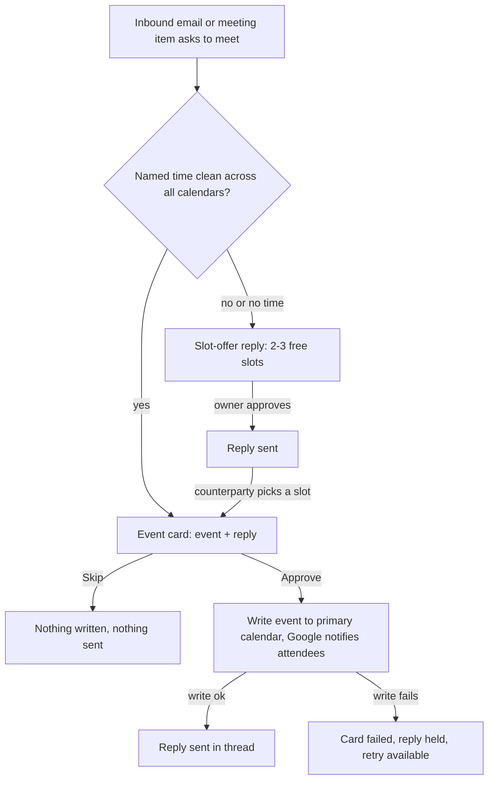
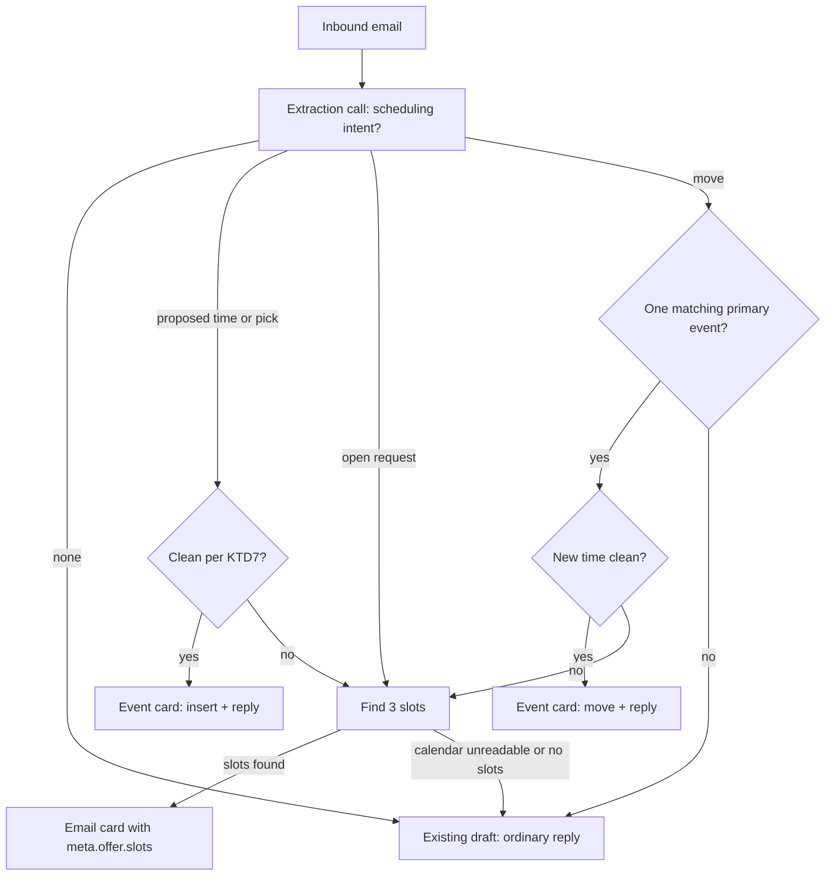
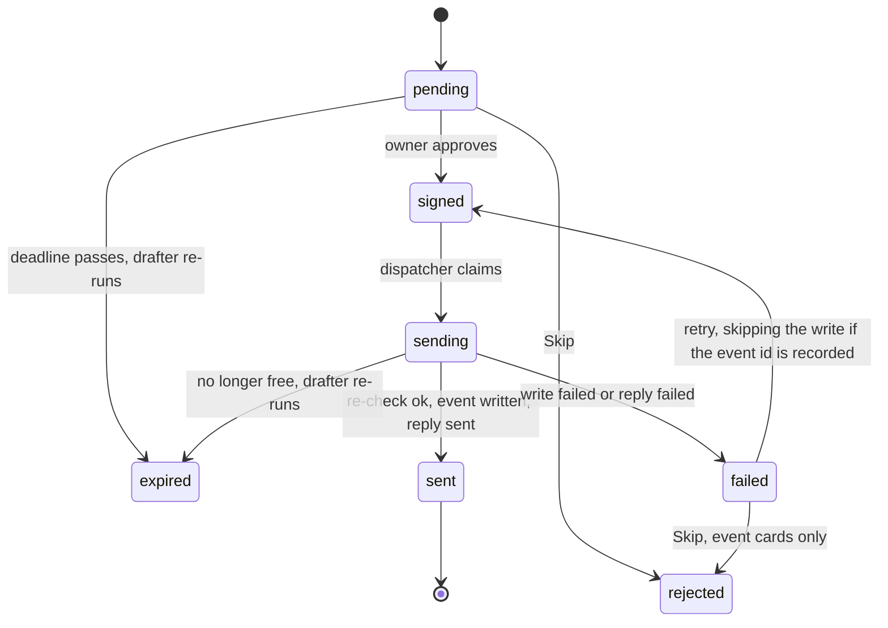

# Google Calendar Claw - Plan

## Goal Capsule

- **Objective:** The owner settles a scheduling request with one approval, and HTR knows the owner's real day, without anything landing on the owner's calendar that the owner did not approve.
- **Product authority:** `_decisions#htr-desk-is-the-product` (ratified 2026-10-19) and `_decisions#integrations-are-the-claws` in the owner's vault. ClickUp: [1.13 Google Calendar claw (read + write)](https://app.clickup.com/t/86bcn3ymq). The desk's Today zone that displays this data is [2.7 Desk v1](https://app.clickup.com/t/86bcn3ymw), not active scope here.
- **Means:** a calendar claw beside the Gmail claw and a new `event` proposal kind dispatched through the existing ruling funnel (KTD3, KTD4).
- **Open blockers:** none. The owner reconnecting Google with calendar access is a launch step, not a planning blocker.
- **Execution profile:** safety-critical (reaches real people through invites and mail). Every unit that writes to the calendar or sends mail is test-first against a fake Google; no test calls real Google.
- **Stop conditions:** stop and ask if a unit needs a calendar write outside dispatch, a write to a calendar other than `primary`, or a change to how existing email proposals send.
- **Who finishes:** `ce-work` builds on branch `tony/86bcn3ymq-calendar-claw` (SOLO lane); Tony approves the PR; nothing deploys to the GCP VM without his "ship it".

---

## Product Contract

Product Contract preservation: changed: R11 moved to Deferred to Follow-Up Work (owner, 2026-10-20); R4 and R13 narrowed per the owner-confirmed planning synthesis (outside working hours and unreadable calendars are not clean; event edits on the web page only); R16, R17 added from the same synthesis; R16 set to redraft as a slot offer (owner, 2026-10-20 review decision).

### Summary

A Google Calendar claw that reads every calendar the owner subscribes to and writes only to the connected account's own calendar, only from an approved card. Scheduling emails and meeting follow-ups become one card that adds or moves the event, sends Google's invite, and replies in the thread in a single approval. When no clean time exists, the card is a reply offering free slots instead.

### Problem Frame

HTR drafts replies to the owner's email, but scheduling mail is where those drafts fall short. A "Tuesday 2pm works" reply leaves the calendar untouched, so the owner still opens Google Calendar, checks for clashes, creates the event, and invites the other person by hand. The desk also has no view of the owner's day, so "what's on today" still means opening a second app. The decision `htr-desk-is-the-product` makes the calendar one of the desk's core claws, read and write.

### Actors

- A1. Owner: rules every card on the surface or phone. One owner per tenant.
- A2. Counterparty: the person emailing or meeting with the owner; receives Google's invite and HTR's reply.
- A3. HTR: reads mail, meetings and calendars; drafts cards; acts only after A1 approves.
- A4. Google Calendar: holds the owner's calendars and sends invite and update emails to attendees.

### Key Decisions

- **Proposals come from inbound mail and meetings, not from owner requests.** HTR spots scheduling in what arrives; meeting follow-ups ship as their own task (see Scope Boundaries). Governs R7, R8, R10. (session-settled: user-directed — chosen over "only when the owner asks" and "both": the desk's job is drafting what comes in, and owner-initiated requests can follow.)
- **One card, one tap.** The event and its reply are ruled together. Governs R12, R13. (session-settled: user-directed — chosen over two separately ruled cards and over event-only with no reply: one approval per scheduling request, and the two can't disagree.)
- **Approval sends Google's invite or update to attendees.** Governs R13. (session-settled: user-directed — chosen over silent calendar-only writes and a per-card choice: the approval is the send, and the card shows who gets notified.)
- **Read every subscribed calendar, write only the primary.** Governs R3, R4, R13. (session-settled: user-directed — chosen over primary-only and over a per-event target calendar: clashes with therapy, Jen or Ekko must count, but writes stay on one calendar.)
- **No clean time means offering 2–3 free slots, with no event yet.** Governs R8, R9. (session-settled: user-directed — chosen over HTR picking one slot and over flagging without a draft: HTR doesn't propose a single time on the owner's behalf.)
- **Calendar access joins the existing Google connection.** One consent covers mail and calendar, so an install connects Google once.
- **Working hours default to weekdays 09:00–17:00 in the tenant's time zone.** Nothing in HTR models availability today; this is the slot-picking window until a setting exists, and a requested time outside it is not clean. Governs R4, R5.
- **Event fields are edited on the web page only.** Phone and digest rulings stay approve or skip. Governs R13.

### Requirements

**Connection and health**

- R1. The owner connects Google once and grants mail and calendar access together; a tenant whose grant covers mail only keeps mail working and reports the calendar as not connected, with a reconnect link.
- R2. The hourly heartbeat probes the calendar claw and reports it down or back up like every other claw.

**Reading the owner's day**

- R3. HTR reads events from every calendar the owner subscribes to for today and the upcoming window, shown in the tenant's time zone.
- R4. A requested time counts as clean only when it is in the future, inside working hours, and free across all subscribed calendars; when the calendars can't be read, no time is clean.
- R5. Free slots are drawn only from the owner's working hours.
- R6. Today's and upcoming events are available to the desk's Today zone as data; its layout belongs to 2.7.

**Scheduling cards**

- R7. When an inbound email asks for a specific time that is clean, HTR proposes one card: the event plus a short reply in that email's thread.
- R8. When a request names no exact time, or the named time is not clean, HTR proposes a reply offering 2–3 free slots and no event.
- R9. When the counterparty's answer picks one of the offered slots, that answer produces an event card per R7, which supersedes the earlier pending draft to that sender.
- R10. When an email asks to move an event HTR can match on the owner's primary calendar, the card proposes the move plus a reply.
- R11. (Moved to Deferred to Follow-Up Work: meeting follow-ups.)

**Ruling and safety**

- R12. Before approval, the card shows the event title, time in the owner's zone, duration, every attendee Google will notify, and the reply text.
- R13. One approval writes the event or the move to the primary calendar with Google notifying the attendees, then sends the reply; Skip drops both, and Edit on the web page changes the time, title, attendees or words first.
- R14. No calendar write happens except from an approved card, and approving or dispatching the same card twice writes once.
- R15. If the calendar write fails, the reply is not sent and the card shows the failure and can be retried.
- R16. At approval HTR checks the time again; when the time is no longer clean, nothing is written or sent, the card closes saying so, and a fresh draft for the same email offers free slots per R8.
- R17. An event card that expires unruled is replaced by a fresh draft for the same email, never re-listed at its old time.



### Acceptance Examples

- AE1. Covers R7, R12, R13.
  - **Given** Sam emails "can we do Tuesday 2pm?" and the owner is free then on every calendar
  - **When** HTR drafts
  - **Then** one card shows "Tue 2:00–2:30 with Sam", names Sam as notified, and carries a short reply; approving puts the event on the primary calendar, Google emails Sam the invite, and the reply goes out in Sam's thread.
- AE2. Covers R8, R9.
  - **Given** Sam writes "let's meet next week"
  - **When** HTR drafts
  - **Then** the card is a reply offering three free slots and no event; after it is sent and Sam answers "Wednesday at 2 works", a new event card for Wednesday 2pm replaces any pending draft to Sam.
- AE3. Covers R4, R8.
  - **Given** the asked time overlaps an event on a non-primary calendar the owner subscribes to
  - **When** HTR drafts
  - **Then** the card offers free slots instead of an event.
- AE4. Covers R14.
  - **Given** an event card
  - **When** the owner skips it, or it expires
  - **Then** no calendar write is attempted; and when an approved card is dispatched twice, exactly one event exists.
- AE5. Covers R1.
  - **Given** a tenant connected Google before this change, with mail access only
  - **When** the heartbeat and the pull run
  - **Then** mail keeps flowing, the calendar reports not connected, and the owner gets a reconnect link.
- AE6. Covers R15.
  - **Given** an approved event card whose calendar write fails
  - **When** dispatch runs
  - **Then** the reply is not sent, the card shows the failure, and a retry can complete both.
- AE7. Covers R16.
  - **Given** an event card for Tuesday 2pm, and Tuesday 2pm gets booked on another calendar before the owner approves
  - **When** the owner approves
  - **Then** nothing is written or sent, the card closes with "Tuesday 2pm is no longer free", and a fresh reply offering free slots is drafted for Sam's email.
- AE8. Covers R17.
  - **Given** an event card the owner never rules on
  - **When** it expires
  - **Then** the card closes and a fresh draft for Sam's email re-checks the calendar.

### Scope Boundaries

- Cancelling or declining events, and responding to invites others send the owner.
- Writing to any calendar other than the connected account's primary one, including Ekko and shared calendars.
- Creating or moving recurring series.
- Microsoft 365 calendar ([4.7](https://app.clickup.com/t/86bcn3yn6)).
- Owner-initiated requests from the desk ("block two hours Thursday").
- A setting or UI for working hours; the default in Key Decisions holds until one exists.
- The Today zone's layout and interaction (2.7 Desk v1).
- Booking links in place of slot offers.

#### Deferred to Follow-Up Work

- Meeting follow-ups (formerly R11): a meeting action item to schedule a follow-up becomes a slot-offer email to the attendees. Needs Fireflies attendee emails kept and a multi-recipient offer; its own ClickUp task.

### Dependencies / Assumptions

- The install's Google OAuth client must allow calendar access; each install brings its own client (`convex/lib/mail/gmail.ts`).
- The owner reconnects Google once after this ships; Ben's install grants calendar access from the start.
- The install's Google OAuth consent screen is published "In production": in "Testing" mode Google expires refresh tokens after 7 days, which would cut mail and calendar off weekly.
- An event with no stated duration defaults to 30 minutes, editable on the card.
- Google's invite plus HTR's reply means the counterparty gets two emails on approval; accepted as normal.

### Outstanding Questions

All four planning questions are answered in the Planning Contract (KTD4, KTD7, KTD6, KTD6).

### Sources / Research

- No calendar code exists in `convex/` or `src/`; `docs/merge-plan.md` lists calendar as a later claw (superseded by `htr-desk-is-the-product`).
- Google consent asks for `gmail.readonly` and `gmail.send` only (`convex/lib/mail/gmail.ts:8`), and the callback rejects a grant missing either (`convex/http.ts:130`); the refresh token lives on `tenant.channels.gmail` (`convex/schema.ts:47`) and feeds the mail claw (`convex/adapters/resolve.ts:30-33`).
- The pattern to follow is the task proposal: the closed kind union (`convex/schema.ts:159`), dispatch through the `DISPATCH` registry only after signing (`convex/mail.ts:229-269`), and the ruling-gate tests (`tests/tasks.test.ts:105-121`, `tests/loop.test.ts:271-291`).
- The drafter makes one email proposal per inbound message and supersedes older pending drafts to the same sender (`convex/drafter.ts:216-230`); meeting action items reach HTR only when the tenant has a task list (`convex/meetings.ts:85-86`).
- The tenant has `timeZone` and `business.bookingLink` (`convex/schema.ts:21`, `:36`); `owner.quietHours` delays alerts only and is not availability (`convex/lib/reader/priority.ts:74`).
- Email-reply rulings don't work on Gmail installs; the surface and ntfy do (`HANDOFF.md:95-96`).

---

## Planning Contract

### Key Technical Decisions

- KTD1. **One consent asks for four scopes: `gmail.readonly`, `gmail.send`, `calendar.readonly`, `calendar.events.owned`.** `calendar.events` can't query free/busy, and `calendar.readonly` alone can't write; this pair is the narrowest that reads every calendar, queries free/busy and writes only to calendars the owner owns. No scope limits writes to `primary`, so every write names `calendarId=primary` and nothing else. The granted scope string is stored on the grant; mail needs both Gmail scopes, calendar needs both calendar scopes (Governs R1).
- KTD2. **One shared Google access-token cache.** Lift the private token cache out of `convex/lib/mail/gmail.ts` into `convex/lib/google/auth.ts`; the mail and calendar clients share it, keyed by refresh token, because one refresh token yields one access token carrying every granted scope.
- KTD3. **A new `calendar` port.** Reads (calendar list, events in a window, free/busy) run unruled; the two writes (insert, move) are called only from the event dispatcher, per the header rule in `convex/adapters/ports.ts`. It resolves only for a Gmail-connected tenant whose grant carries the calendar scopes; otherwise it throws "calendar not connected — reconnect Google", which the heartbeat reports as down (R1, R2).
- KTD4. **An event card is one proposal of kind `event`.** `body` stays the reply text, so edit, lessons and the threaded reply keep working. `meta.event` carries the operation (insert or move), title, start, end, time zone, attendees, the target event id for a move, and the written event id once known. A slot offer is an ordinary `email` proposal carrying `meta.offer.slots`, so a later pick can be matched. Copies the `meta.task` pattern in `convex/schema.ts`.
- KTD5. **Dispatch is idempotent across both writes.** The Google event id is the lowercase hex encoding of the proposal `_id` string's bytes: Convex ids use letters outside Google's base32hex alphabet (0-9, a-v), and hex stays inside it. The dispatcher first GETs that id (or, for a move, the target). If the event already exists at the card's time and isn't cancelled, it skips the re-check and the write and only replies. Otherwise it re-checks the time (R16) with free/busy over every non-hidden calendar except `primary`, plus an events list on `primary` with the card's own or target event dropped, because free/busy carries no event ids and would count the card's own event as busy. It then inserts with `sendUpdates=all` (a 409 counts as written only when the GET returns a non-cancelled event; otherwise the card fails for the owner), records the event id, and sends the reply in thread. A move patches only `start` and `end`, because patch replaces arrays (R13, R14, R15).
- KTD6. **Code decides, the model extracts.** Before the draft call, a small extraction call returns a scheduling intent or none: a proposed time, an open request, a move of a named event, or a pick of an offered slot, with the time read in a zone the email states explicitly, else the tenant's zone. The extraction carries no attendees: an insert card's only attendee is the inbound message's sender address, set in code, so email text can't add invitees; more come only from the owner's web edit (KTD10). A move never changes attendees. Code then decides clean vs. slot offer from calendar data (KTD7) and passes the decision into the existing draft call, which writes the reply text. A pick matches against `meta.offer.slots` on the last outbound offer in the thread. A move matches only a single primary-calendar event the owner organises, with the counterparty attending, in the next 30 days, and its new time is checked with the target event dropped (as in KTD5); anything else becomes an ordinary reply (R7, R8, R9, R10).
- KTD7. **Clean and slot rules.** Busy is the free/busy of every calendar in the list that isn't hidden (up to 50, one request); Google's free/busy already ignores declined and "free" events. Clean is exactly R4, with no lead time. Slots are the first three free starts of the requested duration (default 30 minutes) on a half-hour grid, at least two hours out, within the next 10 working days, preferring different days. An unreadable calendar means no clean time and no slots, so the draft falls back to an ordinary reply (R4, R5, R8).
- KTD8. **The desk reads a stored snapshot, not Google.** A cron refreshes each connected tenant's events for today plus 7 days every 10 minutes into a `calendarEvents` table, and the dispatcher refreshes it after a write. The Today zone queries it reactively, and move matching reads the same snapshot (R3, R6).
- KTD9. **Expiry and dismissal.** An event card's deadline is the earlier of the normal deadline and two hours before its start. On expiry it is not re-listed; the drafter re-runs for its source email (R17). That re-run must get past the drafter's "already drafted" guard: `bySource` returns the newest proposal for a source instead of `.unique()`, and an expired event card doesn't count as drafted. Event cards skip the weekly digest's last-call sweep, so the KTD9 deadline is their only expiry path. A "no longer free" result at dispatch takes the same exit: the card closes as expired with that reason and the drafter re-runs, which now offers slots (R16). A failed event card can be skipped (`failed -> rejected`, for kind `event` only), so "on your calendar, reply not sent" can be dismissed. A failed event card also pushes its reason to the phone with a link to the web page, because an owner who approved from ntfy has no other way to learn nothing was sent (R15).
- KTD10. **Edit lives on the web page.** A surface-key mutation updates `meta.event` and the body together and schedules a clash check that marks the card "no longer free" when needed; the dispatcher's re-check (KTD5) stays the hard gate (R13, R16).

### High-Level Technical Design

Draft path, from inbound mail to a card:



Event card lifecycle (the existing proposal states, plus the event-only additions in KTD9):



Dispatch sequence:

```mermaid
sequenceDiagram
  participant D as Dispatcher
  participant G as Google Calendar
  participant P as Proposal
  participant M as Mail claw
  D->>G: GET derived id (or the move target)
  alt event already at the card's time, not cancelled
    D->>M: reply in thread
    D->>P: sent
  else not yet written
    D->>G: freeBusy (other calendars) + events list on primary without its own event
    alt busy
      D->>P: closed, no longer free; redraft as slot offer (phone push)
    else free
      D->>G: insert with hex id and sendUpdates=all, or patch start/end for a move
      G-->>D: ok, or 409 then GET (non-cancelled = written)
      D->>P: record event id
      D->>M: reply in thread
      D->>P: sent, refresh snapshot
    end
  end
```

### Assumptions

- Google's free/busy excludes declined and "free" (transparent) events; verify on the first live run.
- Re-using an event id after that event was deleted returns 409 and the GET returns it as cancelled; KTD5 fails the card in that case.
- `calendar.events.owned` allows inserting with attendees and `sendUpdates=all`, and `calendar.readonly` covers free/busy on calendars shared free/busy-only; both are confirmed on the first live run, and a failure there fails every write or read visibly.

---

## Implementation Units

### U1. Google consent with calendar scopes and a shared token cache

- **Goal:** One Google connection grants mail and calendar, records what was granted, and both clients share access tokens.
- **Requirements:** R1; KTD1, KTD2.
- **Dependencies:** none.
- **Files:** `convex/lib/google/auth.ts` (new), `convex/lib/mail/gmail.ts`, `convex/gmail.ts`, `convex/http.ts`, `convex/schema.ts`, `tests/gmail.test.ts`, `tests/google-auth.test.ts` (new).
- **Approach:**
  1. Move the access-token cache and refresh call into `convex/lib/google/auth.ts`; `Gmail` uses it.
  2. The consent URL requests all four scopes (KTD1); `include_granted_scopes` stays false, so every reconnect asks for the full set.
  3. The callback accepts a grant carrying both Gmail scopes, with or without calendar, and stores the granted scope on `channels.gmail`. A grant without both Gmail scopes is still refused. The page says which parts were connected.
  4. A grant with no stored scope (connected before this change) counts as mail-only.
- **Execution note:** test-first; consent decides what HTR may do as the owner.
- **Patterns to follow:** `exchangeCode` and `finishConsent` in `convex/gmail.ts`; the `google()` fake fetch in `tests/gmail.test.ts`.
- **Test scenarios:**
  - Covers AE5. A grant saved before this change (no scope) keeps the Gmail pull working, and the calendar resolve reports "not connected".
  - A callback whose token response carries all four scopes stores them, and the page says mail and calendar are connected.
  - A callback with the Gmail scopes but the calendar boxes unticked is accepted, stored as mail-only, and the page says calendar was not connected.
  - A callback missing `gmail.send` is refused as today.
  - Two clients created from the same refresh token trigger one token refresh, not two.
  - An expired cached token is refreshed once before the next call.
- **Verification:** Gmail tests stay green with the moved cache; the new auth tests pass.

### U2. Calendar port, Google adapter and heartbeat

- **Goal:** A `calendar` claw that lists calendars, reads events in a window, queries free/busy, and inserts or moves events on `primary`, with a heartbeat probe.
- **Requirements:** R1, R2, R3, R14; KTD1, KTD3, KTD5.
- **Dependencies:** U1.
- **Files:** `convex/lib/calendar/google.ts` (new), `convex/adapters/ports.ts`, `convex/adapters/vendors.ts`, `convex/adapters/resolve.ts`, `tests/calendar-claw.test.ts` (new), `tests/claws.test.ts`.
- **Approach:**
  1. `CalendarClaw` in `ports.ts` with calendars, events in a window, free/busy, get, insert and move; add `"calendar"` to `Port`.
  2. `convex/lib/calendar/google.ts` wraps the REST calls with fetch only (no SDK), follows pages for events, and uses `singleEvents=true` and `orderBy=startTime`. Every write path is hard-coded to `primary`.
  3. Insert always sends `sendUpdates=all`. Move sends only `start` and `end` with `sendUpdates=all`. A 409 on insert is returned as "exists", not thrown.
  4. `calendarClaw(tenant)` in `resolve.ts` per KTD3; `clawsOf` adds it; the probe runs a short free/busy query across the same calendar set and reports the claw down naming each calendar that returns an error, since one failing calendar makes every time unknown (KTD7).
- **Execution note:** test-first for insert and move.
- **Patterns to follow:** `gmail()` in `convex/adapters/vendors.ts`; the Gmail branch of `mailClaw` and `tryResolve` in `convex/adapters/resolve.ts`.
- **Test scenarios:**
  - Insert posts to `calendars/primary/events` with `sendUpdates=all`, the supplied id, the attendees, and start and end carrying the tenant zone.
  - Insert given a 409 returns "exists" without throwing.
  - Move sends a body with only `start` and `end`; no `attendees` key appears in the request.
  - Events follows `nextPageToken` until it is absent and returns all-day and timed events distinctly.
  - Free/busy sends every non-hidden calendar id in one request and surfaces a per-calendar error as an error, not as free time.
  - The heartbeat reports `calendar` up for a calendar grant and down with "reconnect Google" for a mail-only grant.
  - A per-calendar free/busy error in the probe reports the claw down with that calendar's name.
  - Covers AE4. No code path other than insert and move issues a non-GET request to the calendar API (assert across the fake's recorded calls).
- **Verification:** the claw resolves for a calendar grant, is null-safe for non-Gmail tenants, and shows in `clawHealth`.

### U3. Availability: clean check, slot finder, slot wording

- **Goal:** Pure functions that decide whether a time is clean and pick slots, plus a formatter for times in the owner's zone.
- **Requirements:** R4, R5, R8; KTD7.
- **Dependencies:** none.
- **Files:** `convex/lib/calendar/availability.ts` (new), `convex/lib/time.ts`, `tests/availability.test.ts` (new).
- **Approach:** inputs are busy intervals, now, the tenant zone and the working-hours default. Outputs are a verdict (clean, busy, outside hours, past, unknown) and a slot list. A formatter renders "Wed Oct 21, 2:00 PM" from `localParts`.
- **Patterns to follow:** `atLocalHour` and `localParts` in `convex/lib/time.ts`.
- **Test scenarios:**
  - Covers AE3. A 2pm request overlapping a busy interval from a non-primary calendar is busy.
  - A 6pm weekday request is outside hours, and so is a Saturday request.
  - A request in the past is past; a free request one hour out inside working hours is clean.
  - The slot finder never returns a slot less than two hours out.
  - Busy data marked unreadable gives unknown and no slots.
  - With a free week, three slots come back on three different days, each on the half-hour grid and at least two hours out.
  - A 60-minute duration only yields slots with 60 free minutes.
  - Slots across a DST change land at the right local hour.
  - The formatter prints the owner's local time, not UTC.
- **Verification:** all cases pass with no network.

### U4. Calendar snapshot for the desk

- **Goal:** Today's and the next 7 days' events, across every calendar, stored per tenant and readable reactively.
- **Requirements:** R3, R6; KTD8.
- **Dependencies:** U2.
- **Files:** `convex/schema.ts`, `convex/calendar.ts` (new), `convex/crons.ts`, `tests/calendar-snapshot.test.ts` (new).
- **Approach:** a `calendarEvents` table indexed by tenant and start. A 10-minute cron action replaces each connected tenant's window. A surface-key query returns the window grouped by local day. A failed refresh keeps the last snapshot and records when it was taken.
- **Patterns to follow:** the Gmail pull cron in `convex/gmail.ts` and `convex/crons.ts`; bounded queries per `convex/_generated/ai/guidelines.md`.
- **Test scenarios:**
  - A refresh stores events from two calendars and replaces, not duplicates, them on the next run.
  - A mail-only tenant is skipped.
  - A Google error leaves the previous snapshot in place, and the query reports its age.
  - The query without the surface key is refused.
- **Verification:** the query returns grouped events for a seeded tenant.

### U5. The `event` proposal kind across the surfaces

- **Goal:** Event cards exist end to end: stored, summarised, listed, pushed, rendered in the digest and timeline, with the right buttons.
- **Requirements:** R12, R13; KTD4, KTD9.
- **Dependencies:** none; U6 adds dispatch.
- **Files:** `convex/schema.ts`, `convex/proposals.ts`, `convex/lib/proposals/lifecycle.ts`, `convex/views.ts`, `convex/http.ts`, `convex/digest.ts`, `convex/lib/digest/render.ts`, `convex/lib/notify/ntfy.ts`, `convex/lib/proposals/timeline.ts`, `src/App.tsx`, `tests/lifecycle.test.ts`, `tests/notify.test.ts`, `tests/digest.test.ts`, `tests/timeline.test.ts`.
- **Approach:**
  1. Add `event` to the kind union and `ProposeArgs`; add `meta.event` and `meta.offer`.
  2. Every kind switch in the repo-research table handles `event`: the summary reads "Event: Tue 2:00 PM with Sam", ntfy gets its own title and an "Add + send" button, the digest card shows time and attendees, the timeline says "Added to your calendar, invite sent, replied in thread", and `channelOf` returns email.
  3. `proposals.list` exposes the event fields so `src/App.tsx` can show them (R12); a move card shows the event's current time beside the new one.
  4. `failed -> rejected` is allowed for `event` only (KTD9).
  5. `finishSend` inserts the outbound message row for an event card, since its reply is a message.
  6. The ntfy message for an event card starts with the time, duration and every attendee Google will notify, then the reply text, because ntfy approves without opening anything (R12).
  7. In `src/App.tsx`, a failed event card shows its stored error with Retry and Skip buttons, and its failure sends one phone push naming the reason (R15, KTD9).
- **Patterns to follow:** every `kind === "task"` branch.
- **Test scenarios:**
  - The summary, ntfy title and button read correctly for an insert card and a move card.
  - The digest card lists every attendee Google will notify.
  - Skipping a failed event card is a legal move; skipping a failed email card still isn't.
  - The ntfy message for an insert card and a move card lists the time, duration and every attendee.
  - A failed event card shows its error with Retry and Skip on the web page, and its failure sends one phone push naming the reason.
  - A sent event card leaves one outbound message row in its thread.
- **Verification:** typecheck passes with the new kind; the `DISPATCH` record forces an entry, stubbed to throw until U6.

### U6. Event dispatch

- **Goal:** Approving an event card writes the event or move on `primary`, notifies attendees, then replies in thread, exactly once.
- **Requirements:** R13, R14, R15, R16; KTD5.
- **Dependencies:** U2, U3, U4, U5.
- **Files:** `convex/mail.ts`, `convex/calendar.ts`, `convex/proposals.ts`, `tests/event-dispatch.test.ts` (new).
- **Approach:** a `DISPATCH.event` entry per KTD5 and the dispatch sequence. The event id is recorded by an internal mutation before the reply. A "no longer free" result closes the card with the formatted time in its reason and schedules the redraft (KTD9). Success refreshes the snapshot.
- **Execution note:** test-first; this is the only path that writes to a real calendar and sends invites.
- **Patterns to follow:** `DISPATCH.task` and `tasks.noteTask`; the dispatch tests in `tests/claws.test.ts` and `tests/loop.test.ts`.
- **Test scenarios:**
  - Covers AE1. A signed insert card writes one event with `sendUpdates=all` and the derived id, then replies in the source thread; the proposal ends sent with the event id recorded.
  - Covers AE4. A pending, rejected or expired card dispatches nothing, and dispatching a signed card twice writes one event.
  - Covers AE6. An insert that fails sends no reply, and the card fails with the reason.
  - The event is written, the reply fails, and a retry sends only the reply with no second insert.
  - An insert answered with 409, whose GET returns a live event, is treated as written; one whose GET returns a cancelled event fails the card.
  - The event was written but the id never recorded (crash), and a retry replies without failing as "no longer free".
  - A 60-minute move shifted by 30 minutes isn't blocked by its own old slot.
  - A proposal id containing w-z yields an event id matching `^[0-9a-v]{5,1024}$`, the same id on every call.
  - Covers AE7. A time that became busy closes the card with "Tue 2:00 PM is no longer free", with no write and no reply, and after the scheduled job runs a new pending slot-offer card exists for the same email.
  - A move card GETs the target, patches only start and end, and skips the patch on retry when the times already match.
  - A move whose target was deleted fails the card without inserting a new event.
- **Verification:** every write in the tests goes through an approved card.

### U7. Scheduling in the drafter

- **Goal:** Scheduling emails become event cards or slot offers, and slot picks and move requests are recognised.
- **Requirements:** R7, R8, R9, R10; KTD6, KTD7.
- **Dependencies:** U3, U4, U5.
- **Files:** `convex/drafter.ts`, `convex/lib/calendar/intent.ts` (new), `tests/drafter.test.ts`, `tests/scheduling.test.ts` (new).
- **Approach:**
  1. In the `draft` action, for tenants with a calendar claw, run the extraction call (KTD6) and parse it strictly; anything unparseable means "no scheduling".
  2. Read free/busy for the window in question and decide with U3.
  3. Pass the decision into the existing draft request so the reply text matches: accept the time, offer the formatted slots, or confirm the move.
  4. `record` chooses kind `event`, or `email` with `meta.offer`, and the supersede loop treats `email` and `event` drafts to the same address as one family (R9).
  5. Tenants without a calendar claw draft exactly as today.
- **Execution note:** test-first for the decision step; the model is faked in every test.
- **Patterns to follow:** `toDraft` and `extractJson` in `convex/drafter.ts`; `tests/loop.test.ts` driving `internal.drafter.record` with no model.
- **Test scenarios:**
  - Covers AE1. "Can we do Tuesday 2pm?" with a free calendar yields one event card for Tuesday 2:00–2:30 with the sender as attendee.
  - Covers AE2. "Let's meet next week" yields an email card whose body lists three slots and whose `meta.offer.slots` stores them.
  - Covers AE2. A reply "Wednesday at 2 works" in that thread yields an event card for the stored Wednesday slot and supersedes the pending email draft to the same sender.
  - A pick naming a time that wasn't offered is treated as a proposed time and checked for clean.
  - Covers AE3. A requested time that clashes yields a slot offer, not an event card.
  - A move request matching one owner-organised event yields a move card; zero or two matches yield an ordinary reply.
  - An unreadable calendar yields an ordinary reply with no slots.
  - Malformed extraction output yields an ordinary reply.
  - A mail-only tenant's draft makes no calendar call.
  - An email asking to also invite another address yields an event card whose only attendee is the sender.
  - "2pm ET" for a Pacific-time tenant yields an 11:00 local event.
- **Verification:** the existing drafter and loop tests stay green, and the new cases pass with a faked model and fake Google.

### U8. Expiry and web edit of event cards

- **Goal:** Stale event cards never come back at their old time, and the owner can edit an event's time, title or attendees on the web page.
- **Requirements:** R13, R16, R17; KTD9, KTD10.
- **Dependencies:** U5, U7.
- **Files:** `convex/rulings.ts`, `convex/proposals.ts`, `convex/drafter.ts`, `convex/digest.ts`, `convex/calendar.ts`, `src/App.tsx`, `tests/event-rulings.test.ts` (new).
- **Approach:**
  1. Event cards get the KTD9 deadline at creation. `expirePass` closes an expired event card and schedules the drafter for its source message instead of re-listing it, with the `bySource` and drafter-guard changes in KTD9; the weekly last-call sweep in `convex/digest.ts` skips event cards.
  2. A surface-key `editEvent` mutation updates `meta.event` and the body, then schedules the clash check, which marks the card "no longer free" when it fails.
  3. `src/App.tsx` shows the event fields, with an edit form, on event cards: title, date and time in the tenant zone, duration, attendees (each a validated email address) and the reply text. A move card edits only the new time and the reply. The card shows "checking" while the clash check runs and "no longer free" if it fails.
- **Patterns to follow:** `ruleFromSurface` and the surface-key gate in `convex/rulings.ts`; the existing Edit flow in `src/App.tsx`.
- **Test scenarios:**
  - Covers AE8. An expired event card closes, is not re-listed, and after the scheduled job runs a new pending card exists for the same source email.
  - An event card that sat through a weekly digest is not expired by the last-call sweep.
  - An attendee that isn't a valid email address is refused by `editEvent`.
  - An event card for a meeting three hours out expires one hour from now.
  - Editing the time to a busy slot marks the card "no longer free", and approving it closes the card and redrafts at dispatch.
  - Editing the time to a free slot updates the card, and approval writes the edited time.
  - `editEvent` without the surface key is refused.
- **Verification:** no expired event card is ever re-listed with its old time.

---

## Verification Contract

| Gate | Command | Applies to |
|---|---|---|
| Unit and integration tests | `npm test` | every unit; all green except the 2 known clock-dependent failures in `tests/priority.test.ts` (ClickUp 1.4), which must not grow |
| Types | `npm run typecheck` | every unit |
| No live Google | every Google call in tests goes through a fake fetch | U1, U2, U4, U6, U7, U8 |
| Write gate | the fake records non-GET calendar requests only in `tests/event-dispatch.test.ts` and `tests/calendar-claw.test.ts` | U2, U6 |

Live checks are Tony's, after landing: reconnect Google on the GCP box, send one "can we meet Tuesday 2pm?" email from another account, approve the card, and confirm the invite and the reply arrive.

---

## Definition of Done

- Every unit's test scenarios exist and pass; `npm test` and `npm run typecheck` are green apart from the two known priority-test failures.
- No calendar write exists outside the event dispatcher, and every write names `primary`.
- A mail-only tenant (any grant without the calendar scopes) behaves exactly as before this change.
- The PR body lists the reconnect step, the "In production" consent-screen check, and the ClickUp link.
- No abandoned or experimental code is left in the diff.
